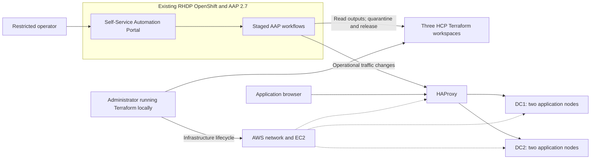

# Self-service datacentre failover with AAP and HCP Terraform

[](https://github.com/kpeacocke/aap-tfe-failover-demo/actions/workflows/ci.yml)
[](LICENSE)

**A customer evaluation demo: Terraform provisions the infrastructure, Ansible
Automation Platform controls failover, and a restricted user initiates the
operation through Self-Service Automation Portal.**

See the traffic move, inspect the staged workflow, and show a real Terraform
workspace quarantine preventing infrastructure changes against the failed site.
Recovery validates the restored site and releases its quarantine **without
automatically moving traffic back**.

> **Evaluation only, not production disaster recovery.** DC1 and DC2 are logical
> sites in two availability zones of one AWS region. The application is
> stateless, the public front door uses HTTP, and a single HAProxy instance is a
> point of failure. Do not use customer data or production credentials.
> Provisioning creates billable resources.

## Start here

| I want to... | Read |
|---|---|
| Understand the design and boundaries | [Architecture](docs/architecture.md) |
| Deploy into my own RHDP lab | [Setup and prerequisites](docs/setup.md) |
| Present the controlled failover | [Presenter runbook](docs/demo-runbook.md) |
| Operate, troubleshoot or tear down | [Operations](docs/operations.md) |
| Run tests and record customer acceptance | [Validation](docs/validation.md) |
| Assess handover readiness and remaining gaps | [Handover review](docs/handover-review.md) |
| Change or contribute to the project | [Contributing](CONTRIBUTING.md) |
| Inspect detailed requirements and historical evidence | [Implementation record](docs/IMPLEMENTATION.md) |

## What this demonstrates

- **Restricted self-service:** the operator sees two approved Portal templates,
  not infrastructure credentials, arbitrary playbooks or administrative controls.
- **Controlled operations:** separate AAP jobs validate the request and actual
  state, check the target, quarantine the source, drain, activate, validate and
  record evidence. Failed operations remain failures even after safe rollback.
- **Infrastructure ownership:** three HCP Terraform workspaces own shared
  infrastructure, DC1 and DC2 independently. AAP does not provision replacements
  during failover.
- **Incident-owned recovery:** only the original incident can release its demo
  quarantine, after healthy isolated standby and active service are verified.
- **Guarded lifecycle:** bootstrap and teardown check identity, ownership,
  active jobs, workspace locks and operation markers. No force-unlock or silent
  marker removal is provided.

## Architecture



RHDP supplies **AAP 2.7 and OpenShift**. This project never installs, upgrades or
removes them. It deploys/reconciles the Portal add-on on that existing cluster,
along with demo-owned AAP content and an execution image. It does not create a
separate Portal appliance.

| Component | Evaluation baseline |
|---|---|
| Terraform service | HCP Terraform Free, `app.terraform.io`, local execution |
| AWS topology | One explicitly verified account/region; five EC2 instances |
| Workspaces | `ww-demo-shared`, `ww-demo-dc1`, `ww-demo-dc2` |
| AAP / OpenShift | Existing AAP 2.7; Portal checks require OpenShift 4.16-4.20 |
| Portal | Pinned `redhat-rhaap-portal` Helm chart 2.2.11 and Portal 2.2 plug-ins |
| Local tooling | Python 3.12-3.14, Terraform 1.9.x, Docker, Git, curl, jq, OpenSSH |

These are the repository's checked/pinned interfaces, not a promise of support
for every release in those ranges. Check current Red Hat support and
entitlements before deploying. The `ww-demo` names remain for state and
ownership-guard compatibility; they are not customer branding.

## Deployment path

Run from a trusted local clone. **Complete the [setup checklist](docs/setup.md)
before running the mutating command.** You need your own RHDP credentials, HCP
organization, verified account/region, registry entitlement and SSH trust.

```bash
git clone https://github.com/kpeacocke/aap-tfe-failover-demo.git
cd aap-tfe-failover-demo
cp .env.example .env
chmod 600 .env
# Edit .env privately; configure your own lab, not the previous demo's values.
# Complete docs/setup.md, including registry consent and SSH trust.
bash scripts/bootstrap.sh profiles/demo.yml --apply
```

The first run may provision AWS and then **stop at the SSH trust boundary**.
Verify the new host fingerprint independently, add only the verified key, then
resume. AAP execution egress also needs its verified `/32` SSH rule; see
[setup](docs/setup.md#verify-aap-execution-access). No blind key acceptance or
wide-open SSH workaround is supported.

After deployment and acceptance, discover current links and readiness:

```bash
bash scripts/demo-status.sh
```

Exit 0 / **READY** checks both sites, traffic, standby isolation, HCP locks,
operation-marker absence, AAP readiness and the Portal HTTPS/anonymous-access
boundary. It makes no remote changes. It is not an exclusive reservation or a
substitute for browser/OAuth acceptance.

## Safety and lifecycle

| Command | Effect |
|---|---|
| `bash scripts/bootstrap.sh profiles/demo.yml` | Reconcile demo configuration; refuses infrastructure changes requiring apply. **Not a dry run.** |
| `bash scripts/bootstrap.sh profiles/demo.yml --apply` | Authorize demo infrastructure creation/changes and platform-content reconciliation. |
| `bash scripts/teardown.sh profiles/demo.yml` | Non-destructive ownership/activity checks and real saved destroy plans. |
| `bash scripts/teardown.sh profiles/demo.yml --confirm-destroy` | **Destroy demo AWS resources** and remove bounded AAP/Portal content. |

Teardown retains reusable identities, Secrets, Portal storage, namespaces,
local keys and the HCP project. Workspace history is retained by default.
Setting `terraform.retain_history: false` in the non-secret profile selects
HCP **safe-delete** of emptied workspaces. This is not a credential/storage
purge. Read [the teardown procedure](docs/operations.md#teardown) first.

Do not run infrastructure changes, manual HAProxy helpers, multiple operators
or live tests concurrently. An interrupted operation can leave quarantine or a
marker intentionally in place; inspect actual state before any approved
administrator recovery.

## Validation and known limits

Credential-free [CI](.github/workflows/ci.yml) checks Terraform, shell/Ansible,
application/browser behavior, real HAProxy fixtures, API contracts, workflow
stages and lifecycle guards. [Manual live acceptance](.github/workflows/live.yml)
is separate and requires lab-specific approvals and secrets.

Historical live acceptance includes Portal failover/recovery in both
directions, a real DC1 outage and standby recovery, read-only readiness, and
authorized destructive teardown with workspace safe-delete. **The original
lab is offline. Recreation after teardown has not been live-validated.**
Repeat [customer acceptance](docs/validation.md#customer-acceptance) in your own
environment; historical green CI is not proof your lab is ready.

Important limits:

- HAProxy restart/replacement resets traffic to its configured DC1 baseline.
- No application-data replication, multi-region recovery, HA front door,
  measured production RTO/RPO, or service-level guarantee is included.
- Workspaces, object allowlists and source URLs are intentionally fixed.
  Use a separate HCP organization per independent deployment. A fork needs
  coordinated [source-configuration changes](docs/setup.md#source-repository-and-revisions).
- Credential rotation is deliberate: existing AAP secrets are not overwritten
  by routine reconciliation. See [operations](docs/operations.md#credentials-and-retained-material).
- GitHub branch protection, live-environment reviewers and security features
  are settings, not installed by cloning this repository. See the
  [handover checklist](docs/handover-review.md#github-owner-settings).

## Repository map

| Path | Purpose |
|---|---|
| [terraform/](terraform/) | Shared/DC infrastructure and application-node module |
| [bootstrap/](bootstrap/) | Declarative AAP/Portal configuration and guarded lifecycle |
| [playbooks/](playbooks/) / [roles/](roles/) | Runtime failover, recovery and validation |
| [portal/](portal/) | Two restricted self-service templates |
| [scripts/](scripts/) | Supported local entrypoints |
| [tests/](tests/) | Credential-free fixtures and explicit opt-in live tests |
| [execution-environment/](execution-environment/) | Pinned demo execution image |
| [docs/](docs/) | Setup, operations, presentation, acceptance and design |

## Support, security and licensing

This is an evaluation reference, not a supported Red Hat or HashiCorp product.
Use [support guidance](SUPPORT.md) for sanitized questions and
[the security policy](SECURITY.md) for private vulnerability reporting.
Never attach environment files, tokens, Terraform state or private keys.

First-party repository content is licensed under [MIT](LICENSE).
Third-party software, container images, collections and Portal components keep
their own licenses and subscription/entitlement requirements.

[AGENTS.md](AGENTS.md) and [Copilot instructions](.github/copilot-instructions.md)
are optional contributor guidance. No agent, Copilot subscription or AI
extension is required to deploy, operate or validate the demo.
